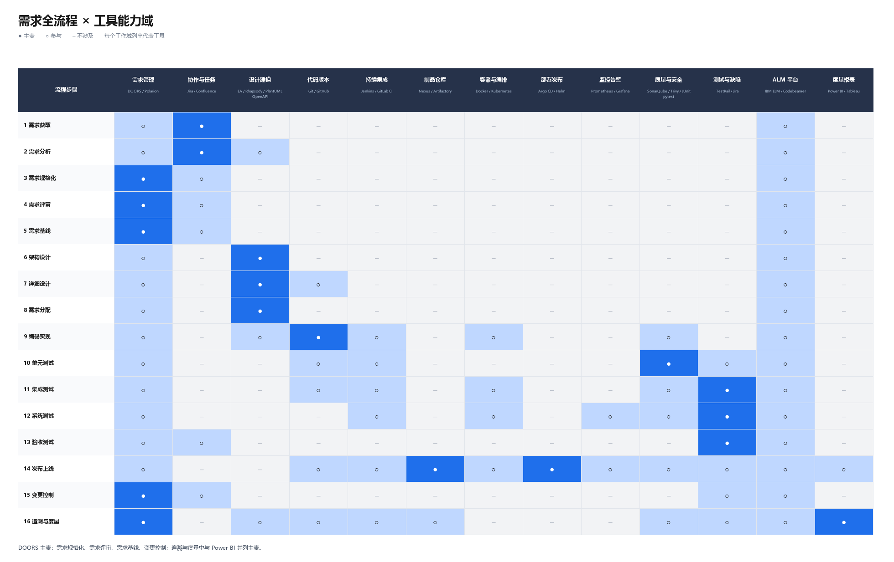

# 需求工程全流程实践指南（卡片版）

> 16 个阶段，每个阶段一张卡片：**目标 · 我做 · 我参与 · 我不做 · 工具 · 坑 · 交接**。
> 阶段划分与能力域图左侧一列严格对应。

---

## 〇、怎么用这份文档

| 你想解决的问题 | 看哪里 |
|---|---|
| 这套流程有没有硬约束 | 一、三条铁律 |
| 快速知道某阶段归谁 | 二、16 阶段总表 |
| 具体某阶段我该做什么 | 三、阶段卡片（对号入座） |
| 选型或对比工具 | 附录 A |
| 系统学习 | 附录 C 资源链接 |

---

## 一、三条铁律

| 铁律 | 含义 | 违反的后果 |
|---|---|---|
| 唯一主责 | 每个阶段有且只有一个工具/角色负责 | 责任真空，出问题互相甩锅 |
| 双向可追溯 | 任一需求能查到“从哪来、到哪去” | 变更漏改，测试漏测 |
| 变更受控 | 改需求必须走流程、留痕迹 | 版本混乱，交付对不上 |

这三条不是流程规定，而是**失效模式的反面**：没有唯一主责，出了问题就互相甩锅；
没有双向追溯，改一处就漏三处；没有变更受控，交付的版本永远说不清。
**任何一条缺失，工具再贵也救不回来。**

---

## 二、16 阶段总表

| # | 阶段 | 我的主责 | 我不做 | 主责工具 |
|---|---|---|---|---|
| 1 | 需求获取 | 访谈与场景梳理 | 需求池工具配置、字段与工作流 →研发/工具链范围 | Jira / Confluence |
| 2 | 需求分析 | 需求分类、优先级、范围裁剪 | 架构方案与技术选型 →架构/研发范围 | Jira |
| 3 | 需求规格化 | 需求分层与措辞、验收标准 | DOORS 模块/属性搭建 →研发范围 | DOORS |
| 4 | 需求评审 | 组织评审、准备材料、跟踪闭环 | 评审流程定义与合规判定 →质量/过程范围 | DOORS 讨论 |
| 5 | 需求基线 | 决定基线时机与范围 | 基线创建与比对操作 → CM/工具链范围 | DOORS 基线 |
| 6 | 架构设计 | 提供需求输入与业务约束 | UML/SysML 建模 →架构师范围 | EA / Rhapsody |
| 7 | 详细设计 | 校验设计覆盖需求与业务规则 | 详细设计本身 →研发范围 | EA / OpenAPI |
| 8 | 需求分配 | 分配原则与业务边界 | 分配矩阵在模型/需求库中的维护 →研发/工具链范围 | DOORS 链接 |
| 9 | 编码实现 | 需求澄清与验收 | 编写生产代码 →研发范围 | Git / GitLab |
| 10 | 单元测试 | 关注关键需求是否被单测覆盖 | 编写与维护单测 →研发范围 | JUnit / pytest |
| 11 | 集成测试 | 确认接口类需求被覆盖 | 环境搭建与依赖准备 →运维/测试开发范围 | Postman / JMeter |
| 12 | 系统测试 | 验收标准与通过门槛 | 用例设计与执行 →测试范围 | TestRail / Xray |
| 13 | 验收测试 | 组织 UAT、判定是否通过 | 验收环境准备 →运维范围 | TestRail / UAT |
| 14 | 发布上线 | 上线范围、时间窗、灰度比例 | 流水线配置、镜像构建 →研发范围 | Jenkins / Argo CD |
| 15 | 变更控制 | 变更必要性与优先级 | 变更单系统配置与流程 →工具链/质量范围 | DOORS 变更单 |
| 16 | 追溯与度量 | 指标口径（什么算“覆盖/通过”） | 数据管道、埋点开发 →研发范围 | DOORS / Power BI |

---

## 三、阶段卡片

### 阶段 1 · 需求获取

**目标**　谁、在什么场景、想要什么
**我做**　访谈与场景梳理 ｜ 干系人清单与需求池质量
**我参与**　业务目标对齐 ｜ 竞品分析
**我不做**　需求池工具配置、字段与工作流（→研发/工具链范围） ｜ 访谈录音转写与归档（可由助理或 AI 完成） ｜ 法务与合规判断（→法务/合规范围）
**工具**　Jira（需求池、Epic/Story） ｜ Confluence（访谈记录、方案文档） ｜ Excel（小团队需求清单） ｜ 禅道 / PingCode（国内一体化研发管理）
**坑**　把方案当需求，需求写成了技术选型 ｜ 只记 happy path，忘了断网、忘带卡等分支 ｜ 没有验收标准，写完不知道怎样算做完
**交接**　原始需求清单 → 需求分析（分类、优先级、冲突裁决）

---

### 阶段 2 · 需求分析

**目标**　哪些做、先做哪个、冲突怎么解
**我做**　需求分类、优先级、范围裁剪 ｜ 冲突识别与裁决提议
**我参与**　技术可行性 ｜ 成本与工期估算
**我不做**　架构方案与技术选型（→架构/研发范围） ｜ 合规与法务判定（→法务范围）
**工具**　Jira（优先级字段、看板） ｜ Excel（价值-成本矩阵） ｜ Confluence（分析报告） ｜ 思维导图工具（场景与依赖梳理）
**坑**　只做功能，不做非功能（性能、安全、可用性） ｜ 优先级全靠拍脑袋，没有依据 ｜ 需求间冲突不记录，后期返工
**交接**　需求分析报告（范围、优先级、依赖、风险）→ 需求规格化

---

### 阶段 3 · 需求规格化

**目标**　怎么写成可验证、可追溯的需求
**我做**　需求分层与措辞、验收标准 ｜ 需求编号规则制定
**我参与**　需求评审会 ｜ 属性字段设计
**我不做**　DOORS 模块/属性搭建（→研发范围） ｜ DXL 脚本、批量导入（→研发范围） ｜ 合规工作产品清单（→质量/过程范围）
**工具**　IBM DOORS（强追溯、强基线） ｜ Siemens Polarion（ALM 一体化） ｜ Jama Connect（现代 SaaS） ｜ Word / Excel（轻量，无追溯）
**坑**　一条需求塞多个“应”，测试无法一一对应 ｜ 用“快速、友好、尽量”等不可验证的词 ｜ 层级超过 5 层，维护成本指数上升 ｜ 只写正文不写属性，无法筛选统计
**交接**　需求规格书（模块 + 对象 + 属性）→ 需求评审

---

### 阶段 4 · 需求评审

**目标**　有没有错、漏、歧义
**我做**　组织评审、准备材料、跟踪闭环 ｜ 决议草稿与整改任务分派
**我参与**　评审结论签认 ｜ 评审流程与检查单模板
**我不做**　评审流程定义与合规判定（→质量/过程范围） ｜ 工具配置与模板开发（→研发/工具链范围）
**工具**　DOORS 讨论（条目级评审留痕） ｜ Confluence（评审记录） ｜ Jira（评审缺陷跟踪） ｜ 会议 + 检查单（正式评审）
**坑**　会而不议，开成汇报会 ｜ 意见不闭环，改没改没人跟踪 ｜ 评审记录丢失，事后无法复盘
**交接**　评审记录与决议 → 需求基线（冻结通过的那一版）

---

### 阶段 5 · 需求基线

**目标**　什么时候冻结，冻结哪一版
**我做**　决定基线时机与范围 ｜ 基线说明与对外发布口径
**我参与**　基线策略与版本号规则 ｜ 基线评审
**我不做**　基线创建与比对操作（→ CM/工具链范围） ｜ 配置管理流程定义（→质量/过程范围）
**工具**　DOORS 基线（需求基线） ｜ Git tag（代码基线） ｜ 发布管理系统（版本归档）
**坑**　需求没稳定就冻结，后面全是变更 ｜ 基线后直接改，绕过变更流程 ｜ 基线没有说明，半年后没人知道为什么冻结
**交接**　基线版本（只读快照 + 清单）→ 架构设计

---

### 阶段 6 · 架构设计

**目标**　系统由哪些部分组成
**我做**　提供需求输入与业务约束 ｜ 评审架构对需求的覆盖
**我参与**　架构方案评审 ｜ 接口的业务语义
**我不做**　UML/SysML 建模（→架构师范围） ｜ 技术选型、性能与容量设计（→架构/研发范围）
**工具**　Sparx Enterprise Architect（UML/SysML，性价比高） ｜ IBM Rhapsody（与 DOORS 同厂、可仿真） ｜ Cameo Systems Modeler（MBSE 标准工具） ｜ Visio / PlantUML（轻量画图）
**坑**　架构脱离需求，为了技术而技术 ｜ 过度建模，画了几百张图没人看 ｜ 架构变更不同步到需求，追溯断裂
**交接**　架构图与组件划分 → 详细设计

---

### 阶段 7 · 详细设计

**目标**　模块内部怎么实现
**我做**　校验设计覆盖需求与业务规则 ｜ 确认业务异常与边界处理
**我参与**　接口契约评审 ｜ 设计评审
**我不做**　详细设计本身（→研发范围） ｜ 代码规范与实现细节（→研发范围）
**工具**　Enterprise Architect（类图/时序图） ｜ PlantUML（文本化建模） ｜ Swagger / OpenAPI（接口契约） ｜ Confluence（设计文档）
**坑**　设计与需求不一致，实现出来对不上验收 ｜ 接口没有契约，联调全靠猜 ｜ 设计文档写完就没人维护
**交接**　详细设计与接口契约 → 需求分配

---

### 阶段 8 · 需求分配

**目标**　每条需求由谁实现
**我做**　分配原则与业务边界 ｜ 确认每条需求有归属
**我参与**　组件划分 ｜ 跨团队需求协调
**我不做**　分配矩阵在模型/需求库中的维护（→研发/工具链范围） ｜ 组件技术边界定义（→架构师范围）
**工具**　DOORS 链接（需求→组件的链接） ｜ EA 分配矩阵（模型内分配） ｜ Excel 矩阵（轻量）
**坑**　需求没有归属，上线了不知道谁做的 ｜ 一条需求被多个组件重复承接，职责冲突 ｜ 分配后不更新，矩阵与实现脱节
**交接**　需求分配矩阵 → 编码实现（各团队按分配领活）

---

### 阶段 9 · 编码实现

**目标**　把需求写成代码
**我做**　需求澄清与验收 ｜ 实现优先级排序
**我参与**　技术方案评审 ｜ 代码评审
**我不做**　编写生产代码（→研发范围） ｜ 分支策略、代码规范、合并发布（→研发范围） ｜ 环境与依赖管理（→研发/运维范围）
**工具**　Git（分布式版本控制） ｜ GitHub / GitLab（托管、评审、CI） ｜ SVN（集中式版本控制） ｜ IDE（IDEA/VS Code）（编码）
**坑**　代码不写需求 ID，上线后无法回答“这段代码为什么存在” ｜ 提交信息随意（fix bug / update），历史无价值 ｜ 长期分支不合并，最后合并地狱
**交接**　代码与提交记录 → 单元测试

---

### 阶段 10 · 单元测试

**目标**　函数和类是否正确
**我做**　关注关键需求是否被单测覆盖 ｜ 确认缺陷修复有回归
**我参与**　覆盖率目标设定 ｜ 测试策略
**我不做**　编写与维护单测（→研发范围） ｜ 流水线与门禁配置（→研发/测试开发范围）
**工具**　JUnit / pytest / Jest（单元测试框架） ｜ JaCoCo / coverage.py（覆盖率统计） ｜ SonarQube（静态扫描与质量门禁） ｜ Mockito 等（打桩）
**坑**　为覆盖率写无意义断言（assert 恒真） ｜ 只测正常分支，不测异常与边界 ｜ 单测通过就认为需求实现正确
**交接**　单元测试与覆盖率 → 集成测试

---

### 阶段 11 · 集成测试

**目标**　模块之间能不能通
**我做**　确认接口类需求被覆盖 ｜ 确认跨系统业务规则
**我参与**　联调计划与时间窗 ｜ 接口变更通知
**我不做**　环境搭建与依赖准备（→运维/测试开发范围） ｜ 自动化脚本编写（→测试开发范围）
**工具**　Postman / Newman（接口测试） ｜ JMeter（接口与性能） ｜ Testcontainers（容器化依赖） ｜ TestRail / Xray（用例管理）
**坑**　接口改了不通知，联调时才发现 ｜ 测试环境与生产不一致，测过也白测 ｜ 只测连通性，不测异常与超时
**交接**　集成测试报告 → 系统测试

---

### 阶段 12 · 系统测试

**目标**　端到端是否符合系统需求
**我做**　验收标准与通过门槛 ｜ 业务场景与数据准备
**我参与**　测试方案评审 ｜ 缺陷优先级判定
**我不做**　用例设计与执行（→测试范围） ｜ 缺陷根因分析（→研发范围）
**工具**　TestRail / Xray / ETM（用例与执行管理） ｜ JMeter / LoadRunner（性能压测） ｜ Selenium / Playwright（UI 自动化） ｜ 安全扫描工具（漏洞扫描）
**坑**　只测功能，不测性能与安全 ｜ 通过率造假（跳过失败用例） ｜ 缺陷不定级，全都“紧急”
**交接**　系统测试报告与缺陷清单 → 验收测试

---

### 阶段 13 · 验收测试

**目标**　业务是否接受
**我做**　组织 UAT、判定是否通过 ｜ 验收标准解释与争议裁决
**我参与**　遗留缺陷豁免 ｜ 上线时间窗
**我不做**　验收环境准备（→运维范围） ｜ 缺陷修复（→研发范围）
**工具**　TestRail / Excel（验收用例与结果） ｜ 客户环境（真实数据验证） ｜ Jira（遗留问题跟踪）
**坑**　验收标准模糊，最后靠“感觉”验收 ｜ 用户不参与，上线后才发现不合用 ｜ 带缺陷上线但没有书面豁免记录
**交接**　验收报告与签字 → 发布上线

---

### 阶段 14 · 发布上线

**目标**　何时、发多少、怎么回滚
**我做**　上线范围、时间窗、灰度比例 ｜ 发布说明与业务通知
**我参与**　发布方案与回滚预案 ｜ 业务监控指标
**我不做**　流水线配置、镜像构建（→研发范围） ｜ K8s 部署、扩缩容（→运维/SRE 范围） ｜ 告警规则与值班（→ SRE 范围）
**工具**　Jenkins / GitLab CI（构建流水线） ｜ Nexus / Harbor（制品与镜像仓库） ｜ Docker / Kubernetes（容器与编排） ｜ Argo CD / Helm（GitOps 发布）
**坑**　制品没有版本语义，不知道对应哪版需求 ｜ 部署记录与变更单脱节，出事查不到根因 ｜ 告警不带业务维度，只知道 CPU 高
**交接**　发布记录与监控数据 → 变更控制

---

### 阶段 15 · 变更控制

**目标**　改不改、影响谁、谁批
**我做**　变更必要性与优先级 ｜ 影响范围确认与需求文本更新
**我参与**　变更审批（CCB） ｜ 技术影响评估
**我不做**　变更单系统配置与流程（→工具链/质量范围） ｜ 回归测试执行与代码修改（→测试/研发范围）
**工具**　DOORS 变更单（登记与关联需求） ｜ DOORS 可疑链接（上游改了自动标记下游） ｜ Jira Workflow（审批流） ｜ ServiceNow（企业级审批）
**坑**　只改需求不改测试，用例还是老的 ｜ 不做影响分析，改一处崩三处 ｜ 变更单不闭环，状态永远“处理中”
**交接**　变更记录与影响清单 → 追溯与度量

---

### 阶段 16 · 追溯与度量

**目标**　每条需求能否追到底、过程可不可度量
**我做**　指标口径（什么算“覆盖/通过”） ｜ 覆盖率目标与复盘改进
**我参与**　数据源接入方案 ｜ 指标实现与校验
**我不做**　数据管道、埋点开发（→研发范围） ｜ BI 建模与看板制作（→ BI/数据范围）
**工具**　DOORS 链接与矩阵（追溯关系） ｜ Power BI / Tableau（指标看板） ｜ Grafana（实时看板） ｜ Excel / CSV（一次性分析）
**坑**　为了指标而指标，覆盖率刷到 100% 但测的是废话 ｜ 各工具口径不一致，覆盖率与通过率对不上 ｜ 只看单点数字，不看趋势
**交接**　追溯矩阵与指标 → 下一轮需求获取（形成闭环）

---

## 附录 A、工具格局与选型

| 工具 | 主要行业 | 现状 |
|---|---|---|
| IBM DOORS | 航空、航天、军工、汽车、轨交 | 存量巨大，大型项目首选 |
| Siemens Polarion | 汽车、医疗器械 | ALM 一体化，欧洲车企常用 |
| Jama Connect | 医疗、半导体、软件 | SaaS 化，协作体验好 |
| Codebeamer | 汽车零部件 | 系统工程师向 |
| Jira + 插件 | 互联网、软件 | 轻量替代，追溯靠插件 |
| 禅道 / PingCode | 国内中小团队 | 一体化研发管理，性价比高 |

| 场景 | 推荐 | 理由 |
|---|---|---|
| 航空/军工/轨交，强审计 | DOORS + ETM + Git | 行业标准，追溯与基线成熟 |
| 汽车零部件，ASPICE | Polarion 或 Codebeamer | 与 ASPICE 流程贴合 |
| 互联网产品，快速迭代 | Jira + Confluence + GitLab | 轻、快、协作好 |
| 中型企业，预算有限 | 禅道/PingCode + GitLab | 一体化和成本平衡 |
| 医疗设备，FDA 审计 | Jama 或 DOORS | 审计追踪强 |

---

## 附录 B、常见误区

| 误区 | 事实 |
|---|---|
| DOORS 能跑测试 | 不能。只存用例与结果，执行在测试工具/CI |
| 工具越多越专业 | 不是。每步应有唯一主责，工具多反而增加集成成本 |
| 追溯就是画个矩阵 | 矩阵只是展示，难点在链接的建立与维护 |
| 基线 = 备份 | 基线是可对比的只读快照，比备份多了版本语义 |
| 变更影响分析靠经验 | 应基于链接图做一跳/二跳遍历 |
| 需求文档写完就结束 | 需求要贯穿到代码、测试、发布，否则无法验收 |

---

## 附录 C、学习资源

| 主题 | 资源 | 链接 |
|---|---|---|
| DOORS 官方文档 | IBM Docs | https://www.ibm.com/docs/en/engineering-lifecycle-management-suite/doors/9.6.0 |
| ALM 全景 | IBM ELM | https://www.ibm.com/products/engineering-lifecycle-management |
| 系统工程 | INCOSE Handbook | https://www.incose.org/products-and-publications/se-handbook |
| 需求认证 | IREB CPRE | https://www.ireb.org/ |
| 协作 | Jira 指南 | https://www.atlassian.com/software/jira/guides |
| 协作 | Confluence 指南 | https://www.atlassian.com/software/confluence/guides |
| 建模 | Sparx EA 教程 | https://sparxsystems.com/resources/tutorials/ |
| 建模 | Rhapsody | https://www.ibm.com/products/systems-design-rhapsody |
| 代码 | Pro Git 中文 | https://git-scm.com/book/zh/v2 |
| CI | Jenkins 文档 | https://www.jenkins.io/doc/ |
| CI | GitLab CI 文档 | https://docs.gitlab.com/ee/ci/ |
| 制品 | Nexus 文档 | https://help.sonatype.com/ |
| 制品 | Artifactory 文档 | https://jfrog.com/help/ |
| 容器 | Docker 文档 | https://docs.docker.com/ |
| 容器 | Kubernetes 中文 | https://kubernetes.io/zh-cn/docs/home/ |
| 部署 | Argo CD | https://argo-cd.readthedocs.io/ |
| 部署 | Helm | https://helm.sh/docs/ |
| 监控 | Prometheus | https://prometheus.io/docs/introduction/overview/ |
| 监控 | Grafana | https://grafana.com/docs/ |
| 质量 | SonarQube | https://docs.sonarsource.com/ |
| 安全 | Trivy | https://trivy.dev/ |
| 测试 | TestRail | https://support.testrail.com/ |
| 测试认证 | ISTQB | https://www.istqb.org/ |
| 度量 | Power BI 中文 | https://learn.microsoft.com/zh-cn/power-bi/ |
| 标准 | Automotive SPICE | https://www.automotivespice.com/ |

---

## 附录 D、回到本项目

| 想做什么 | 看哪份文档 |
|---|---|
| 完整链路怎么搭起来 | [使用文档.md](03-DOORS-使用文档.md) |
| DOORS 每个功能怎么点 | [核心功能操作手册.md](04-DOORS-操作手册.md) |
| 工具边界与集成方式 | [工具能力域表.md](01-工具链全景.md) |
| 能力域全景图 | `diagrams/phase-tool-matrix.png` |
